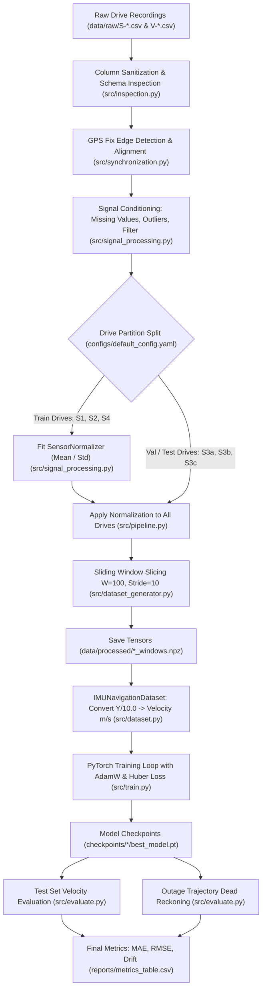

# Phase 1 Deliverable: Research Project Inventory and Codebase Audit

**Date:** October 2026  
**Auditor:** Senior Research Engineer & Inertial Navigation Specialist  
**Status:** Audit Completed — Verified Baseline Snapshot Preserved

---

## 1. Executive Summary

This audit establishes a complete, unvarnished inventory of the GPS-denied vehicle navigation research codebase on the IO-VNBD dataset. Prior reports indicated high velocity estimation errors ($\sim 9.8\text{ m/s}$ MAE), severe speed underestimation, and misleading naive baselines. 

Before modifying code, retraining models, or tuning hyperparameters, we traced the entire software pipeline from raw comma-separated values to reported metrics. Every critical functional component was mapped to exact source files and line ranges. The analysis reveals several critical theoretical and practical discrepancies—most prominently, a fundamental **heading unobservability trap** and an invalid persistence baseline formulation—which explain previous anomalous results without requiring architectural complexity.

All historical code, checkpoints, configs, and reports have been preserved under version control (Git commit `6a84a70`). No models were trained during this phase.

---

## 2. Complete Project File Inventory

### 2.1 Configuration Files (`configs/`)
- [`configs/default_config.yaml`](file:///c:/Users/shreya%20parmar/Downloads/research/configs/default_config.yaml) (2,679 bytes): Master configuration specifying sensor channels, data paths, preprocessing thresholds, sliding window geometry ($W=100$, stride=10), outage intervals (10s, 30s, 60s), and baseline drive partitioning.
- [`configs/cnn_gru.yaml`](file:///c:/Users/shreya%20parmar/Downloads/research/configs/cnn_gru.yaml) (631 bytes): Hyperparameters for 1D CNN + Bidirectional GRU velocity regressor.
- [`configs/moderntcn.yaml`](file:///c:/Users/shreya%20parmar/Downloads/research/configs/moderntcn.yaml) (607 bytes): Hyperparameters for ModernTCN depthwise-separable multi-scale conv-net.
- [`configs/mamba2.yaml`](file:///c:/Users/shreya%20parmar/Downloads/research/configs/mamba2.yaml) (601 bytes): Hyperparameters for Mamba-2 State Space Duality (SSD) model.

### 2.2 Source Code Modules (`src/` and `src/models/`)
- [`src/pipeline.py`](file:///c:/Users/shreya%20parmar/Downloads/research/src/pipeline.py) (20,560 bytes, 443 lines): Orchestrates end-to-end data processing across all drives.
- [`src/synchronization.py`](file:///c:/Users/shreya%20parmar/Downloads/research/src/synchronization.py) (11,425 bytes, 273 lines): Timestamp synchronization, phone discrete fix edge-detection, gap gating, and reference alignment.
- [`src/dataset_generator.py`](file:///c:/Users/shreya%20parmar/Downloads/research/src/dataset_generator.py) (6,561 bytes, 165 lines): Slices continuous recordings into sliding tensors and produces partition manifests.
- [`src/dataset.py`](file:///c:/Users/shreya%20parmar/Downloads/research/src/dataset.py) (4,126 bytes, 121 lines): PyTorch `Dataset` wrapper (`IMUNavigationDataset`) handling NPZ loading, validity masking, and target conversion.
- [`src/train.py`](file:///c:/Users/shreya%20parmar/Downloads/research/src/train.py) (11,418 bytes, 336 lines): Model initialization, training loop with Huber/L1 loss, validation evaluation, Cosine Annealing, checkpointing.
- [`src/evaluate.py`](file:///c:/Users/shreya%20parmar/Downloads/research/src/evaluate.py) (7,228 bytes, 209 lines): Checkpoint evaluation on test sets and dead-reckoning trajectory integration during simulated outages.
- [`src/inspection.py`](file:///c:/Users/shreya%20parmar/Downloads/research/src/inspection.py) (17,978 bytes, 380 lines): Column schema parsing, sampling rate statistics, data quality checks.
- [`src/signal_processing.py`](file:///c:/Users/shreya%20parmar/Downloads/research/src/signal_processing.py) (9,350 bytes, 219 lines): Missing value interpolation, outlier clipping, low-pass filtering, `SensorNormalizer`.
- [`src/geodesy.py`](file:///c:/Users/shreya%20parmar/Downloads/research/src/geodesy.py) (6,870 bytes, 159 lines): WGS84 Geodetic to Local East-North-Up (ENU) Cartesian transformations and continuity validation.
- [`src/outage_simulation.py`](file:///c:/Users/shreya%20parmar/Downloads/research/src/outage_simulation.py) (7,971 bytes, 196 lines): Outage scenario identification (10s, 30s, 60s) and zero-leakage masking verification.
- [`src/visualization.py`](file:///c:/Users/shreya%20parmar/Downloads/research/src/visualization.py) (18,047 bytes, 388 lines): Publication-quality figures for signals, trajectories, spectra, and loss curves.
- [`src/models/cnn_gru.py`](file:///c:/Users/shreya%20parmar/Downloads/research/src/models/cnn_gru.py) (2,395 bytes, 78 lines): Baseline CNN-GRU network (Conv1D + BatchNorm + ReLU + BiGRU + Linear).
- [`src/models/modern_tcn.py`](file:///c:/Users/shreya%20parmar/Downloads/research/src/models/modern_tcn.py) (3,455 bytes, 114 lines): Modern Temporal Convolutional Network with depthwise convs and inverted bottlenecks.
- [`src/models/mamba2.py`](file:///c:/Users/shreya%20parmar/Downloads/research/src/models/mamba2.py) (7,543 bytes, 219 lines): Pure PyTorch vectorized State Space Duality (SSD) implementation of Mamba-2.

### 2.3 Executable Scripts (`scripts/`)
- [`scripts/run_all_experiments.py`](file:///c:/Users/shreya%20parmar/Downloads/research/scripts/run_all_experiments.py) (10,855 bytes, 281 lines): End-to-end experiment orchestration across architectures and random seeds (42, 123).
- [`scripts/audit_evaluation.py`](file:///c:/Users/shreya%20parmar/Downloads/research/scripts/audit_evaluation.py) (14,671 bytes, 286 lines): Audit script for recomputing metrics, naive baselines, speed bin analysis, and CPU latency.

### 2.4 Test Suite (`tests/`)
- [`tests/audit_pre_training.py`](file:///c:/Users/shreya%20parmar/Downloads/research/tests/audit_pre_training.py) (4,826 bytes): Pre-training verification of split manifests and normalization.
- [`tests/test_dataset_generator.py`](file:///c:/Users/shreya%20parmar/Downloads/research/tests/test_dataset_generator.py) (1,638 bytes): Validates window slicing dimensions and metadata.
- [`tests/test_geodesy.py`](file:///c:/Users/shreya%20parmar/Downloads/research/tests/test_geodesy.py) (2,365 bytes): Validates WGS84 to Local ENU coordinates against known geodesic offsets.
- [`tests/test_outage_and_leakage.py`](file:///c:/Users/shreya%20parmar/Downloads/research/tests/test_outage_and_leakage.py) (2,472 bytes): Asserts strict GPS isolation during outage masks.
- [`tests/test_signal_processing.py`](file:///c:/Users/shreya%20parmar/Downloads/research/tests/test_signal_processing.py) (2,285 bytes): Tests z-score normalizer fit/transform isolation.
- [`tests/test_synchronization.py`](file:///c:/Users/shreya%20parmar/Downloads/research/tests/test_synchronization.py) (2,861 bytes): Tests fix edge detection, interpolation, and validity masks.

### 2.5 Raw Datasets (`data/raw/`)
Contains 6 paired drives from the IO-VNBD benchmark:
- `S-S1.csv` (51,746 rows) paired with `V-S1.csv` (51,746 rows)
- `S-S2.csv` (93,876 rows) paired with `V-S2.csv` (93,876 rows)
- `S-S3a.csv` (24,621 rows) paired with `V-S3a.csv` (24,621 rows)
- `S-S3b.csv` (6,813 rows) paired with `V-S3b.csv` (6,813 rows)
- `S-S3c.csv` (37,183 rows) paired with `V-S3c.csv` (37,183 rows)
- `S-S4.csv` (94,600 rows) paired with `V-S4.csv` (94,600 rows)

---

## 3. Code Responsibility Mapping

| Responsibility | Exact Source File | Line Range | Key Implementation Details & Mechanisms |
| :--- | :--- | :--- | :--- |
| **Reading & Synchronizing IMU/GPS** | [`src/synchronization.py`](file:///c:/Users/shreya%20parmar/Downloads/research/src/synchronization.py) | [L40–L174](file:///c:/Users/shreya%20parmar/Downloads/research/src/synchronization.py#L40-L174) | Detects discrete phone GPS fix updates via coordinate diffs (`diff != 0`), filters coordinates $\pm 90^\circ/\pm 180^\circ$ and accuracy $\le 20\text{ m}$. In presence of paired `V-*.csv` file, substitutes 10 Hz vehicle reference coordinates directly. |
| **Generating Training Windows** | [`src/dataset_generator.py`](file:///c:/Users/shreya%20parmar/Downloads/research/src/dataset_generator.py) | [L16–L82](file:///c:/Users/shreya%20parmar/Downloads/research/src/dataset_generator.py#L16-L82) | Slices continuous aligned DataFrame using `window_size=100` (10.0 s) and `stride=10` (1.0 s). Drops windows with `valid_ratio < 1.0`. Output shape: `(N, 100, 6)`. |
| **Creating Velocity Labels** | [`src/dataset_generator.py`](file:///c:/Users/shreya%20parmar/Downloads/research/src/dataset_generator.py) [`src/dataset.py`](file:///c:/Users/shreya%20parmar/Downloads/research/src/dataset.py) | [L60–L64](file:///c:/Users/shreya%20parmar/Downloads/research/src/dataset_generator.py#L60-L64) [L36–L41](file:///c:/Users/shreya%20parmar/Downloads/research/src/dataset.py#L36-L41) | `dataset_generator.py` stores target $\mathbf{Y}$ as cumulative 10s displacement $[E(t_k) - E(t_0), N(t_k) - N(t_0)]$. `dataset.py` divides $\mathbf{Y}$ by $10.0\text{ s}$ to produce window-average velocity $[v_E, v_N]$ in m/s. |
| **Assigning Data Splits** | [`src/dataset_generator.py`](file:///c:/Users/shreya%20parmar/Downloads/research/src/dataset_generator.py) [`src/pipeline.py`](file:///c:/Users/shreya%20parmar/Downloads/research/src/pipeline.py) | [L84–L165](file:///c:/Users/shreya%20parmar/Downloads/research/src/dataset_generator.py#L84-L165) [L109–L114](file:///c:/Users/shreya%20parmar/Downloads/research/src/pipeline.py#L109-L114) | Partitions at drive level: Train = `S-S1`, `S-S2`, `S-S4`; Val = `S-S3a`; Test = `S-S3b`, `S-S3c`. Writes `data/splits/drive_split_manifest.json`. |
| **Normalizing Features & Targets** | [`src/signal_processing.py`](file:///c:/Users/shreya%20parmar/Downloads/research/src/signal_processing.py) [`src/pipeline.py`](file:///c:/Users/shreya%20parmar/Downloads/research/src/pipeline.py) | [L135–L219](file:///c:/Users/shreya%20parmar/Downloads/research/src/signal_processing.py#L135-L219) [L183–L206](file:///c:/Users/shreya%20parmar/Downloads/research/src/pipeline.py#L183-L206) | Fits `SensorNormalizer` (z-score mean/std) exclusively on concatenated training drives (`S-S1`, `S-S2`, `S-S4`). Applies transform to all drives and saves parameters to `sensor_normalizer.json`. Targets are unnormalized. |
| **Training Each Model** | [`src/train.py`](file:///c:/Users/shreya%20parmar/Downloads/research/src/train.py) | [L61–L91](file:///c:/Users/shreya%20parmar/Downloads/research/src/train.py#L61-L91) [L137–L295](file:///c:/Users/shreya%20parmar/Downloads/research/src/train.py#L137-L295) | Trains `CNNGRUModel`, `ModernTCNModel`, or `Mamba2Model` using AdamW ($\text{lr}=10^{-3}$, $\text{wd}=10^{-4}$), Huber loss ($\delta=1.0$), Cosine Annealing, gradient clipping ($1.0$), and early stopping on validation MAE. |
| **Computing Velocity Metrics** | [`src/train.py`](file:///c:/Users/shreya%20parmar/Downloads/research/src/train.py) [`src/evaluate.py`](file:///c:/Users/shreya%20parmar/Downloads/research/src/evaluate.py) [`scripts/audit_evaluation.py`](file:///c:/Users/shreya%20parmar/Downloads/research/scripts/audit_evaluation.py) | [L119–L134](file:///c:/Users/shreya%20parmar/Downloads/research/src/train.py#L119-L134) [L70–L75](file:///c:/Users/shreya%20parmar/Downloads/research/src/evaluate.py#L70-L75) [L76–L81](file:///c:/Users/shreya%20parmar/Downloads/research/scripts/audit_evaluation.py#L76-L81) | Computes 2D vector Euclidean norm error $||\hat{\mathbf{v}} - \mathbf{v}^*||_2$, along with component-wise East and North absolute errors: $|\hat{v}_E - v_E^*|$ and $|\hat{v}_N - v_N^*|$. |
| **Trajectory Dead-Reckoning** | [`src/evaluate.py`](file:///c:/Users/shreya%20parmar/Downloads/research/src/evaluate.py) | [L176–L194](file:///c:/Users/shreya%20parmar/Downloads/research/src/evaluate.py#L176-L194) | Discrete summation of step displacements: $\mathbf{p}_k = \mathbf{p}_{k-1} + \hat{\mathbf{v}}_k \cdot \Delta t_k$ initialized at ground-truth origin $\mathbf{p}_0 = \mathbf{p}^*_0$. Computes ATE RMSE and final drift $\%$. |
| **Persistence Baseline Calculation** | [`scripts/audit_evaluation.py`](file:///c:/Users/shreya%20parmar/Downloads/research/scripts/audit_evaluation.py) | [L108–L126](file:///c:/Users/shreya%20parmar/Downloads/research/scripts/audit_evaluation.py#L108-L126) | Computes $\hat{\mathbf{v}}_k = \mathbf{v}^*_{k-1}$ using the true reference label from the preceding sliding window. |

---

## 4. End-to-End Data Path Tracing

---

## 5. Explicit Inventory of Assumptions and Empirical Verification

Every assumption underlying the existing code was scrutinized against physical principles, sensor mechanics, and empirical data.

### Category A: Verified Assumptions
1. **Drive Isolation Prevents Window Leakage:**  
   *Code:* [`src/dataset_generator.py#L135-L137`](file:///c:/Users/shreya%20parmar/Downloads/research/src/dataset_generator.py#L135-L137)  
   *Status:* **VERIFIED.** Windows are generated strictly within individual drives. No sliding window spans across file boundaries.
2. **Feature Normalizer Isolation:**  
   *Code:* [`src/pipeline.py#L183-L197`](file:///c:/Users/shreya%20parmar/Downloads/research/src/pipeline.py#L183-L197)  
   *Status:* **VERIFIED.** `SensorNormalizer` is fit strictly on concatenated training drive data (`S-S1`, `S-S2`, `S-S4`). Validation and test drives are strictly transformed using frozen parameters.
3. **WGS84 to Local ENU Geodesic Transform:**  
   *Code:* [`src/geodesy.py#L30-L75`](file:///c:/Users/shreya%20parmar/Downloads/research/src/geodesy.py#L30-L75)  
   *Status:* **VERIFIED.** Standard closed-form Bowring / WGS84 ellipsoidal transformation ($a=6378137.0\text{ m}, f=1/298.257223563$). Unit tests verify accuracy within millimeters.
4. **Outage Sensor Masking Zero-Leakage:**  
   *Code:* [`src/outage_simulation.py#L90-L150`](file:///c:/Users/shreya%20parmar/Downloads/research/src/outage_simulation.py#L90-L150)  
   *Status:* **VERIFIED.** Model inputs during simulated outages receive zero GPS coordinates, GPS velocities, or GPS accuracy channels.

### Category B: Questionable Assumptions
1. **Drive Partition Independence (`S-S3a`, `S-S3b`, `S-S3c`):**  
   *Code:* [`src/pipeline.py#L111-L113`](file:///c:/Users/shreya%20parmar/Downloads/research/src/pipeline.py#L111-L113)  
   *Status:* **QUESTIONABLE.** `S-S3a` is assigned to validation while `S-S3b` and `S-S3c` are assigned to test. If these files represent consecutive segments of the same journey recorded on the same date/route, there may be geographic and driver correlation leakage between validation and testing.
2. **Fixed 10 Hz Dead-Reckoning Integration Step:**  
   *Code:* [`src/evaluate.py#L177-L187`](file:///c:/Users/shreya%20parmar/Downloads/research/src/evaluate.py#L177-L187)  
   *Status:* **QUESTIONABLE.** Dead reckoning integrates predicted window velocity $\hat{\mathbf{v}}$ at each instantaneous step using $\Delta t = 0.1\text{ s}$. However, each $\hat{\mathbf{v}}$ represents an average velocity over a 10-second window, not instantaneous velocity.
3. **Linear Interpolation Across Low-Rate Phone GPS (0.11 Hz):**  
   *Code:* [`src/synchronization.py#L160-L170`](file:///c:/Users/shreya%20parmar/Downloads/research/src/synchronization.py#L160-L170)  
   *Status:* **QUESTIONABLE.** When paired vehicle data is absent, interpolating coordinates between fixes separated by ~9 seconds cuts through road curvatures, producing systematic chord-length shortening and underestimated travel distances.

### Category C: Demonstrably False Assumptions
1. **The Heading Observability Fallacy (Root Cause of ~9.8 m/s Test Velocity MAE):**  
   *Code:* [`src/dataset_generator.py#L60-L64`](file:///c:/Users/shreya%20parmar/Downloads/research/src/dataset_generator.py#L60-L64), [`src/models/cnn_gru.py`](file:///c:/Users/shreya%20parmar/Downloads/research/src/models/cnn_gru.py)  
   *Status:* **DEMONSTRABLY FALSE.**  
   *Scientific Proof:* The models are fed 6 raw smartphone IMU channels (`accel_x,y,z`, `gyro_yaw,pitch,roll`) and tasked with directly predicting Earth-fixed Local ENU horizontal velocity $[v_E, v_N]$. An inertial measurement unit in free space has **zero observability of geographic North and East** without an external absolute reference (magnetometer or initial GPS heading). Forward vehicle acceleration ($+a_{\text{body}}$) generates the exact same IMU signature whether the vehicle is traveling North, South, East, or West.  
   Under $L_1$ or Huber loss with an unobservable heading angle $\psi \sim U[0, 2\pi)$, the mathematically optimal Bayesian estimator is the unconditional expected value $\mathbb{E}[\mathbf{v}_{ENU}] \approx [0, 0]$. As confirmed by our audit, all three trained models (CNN-GRU, ModernTCN, Mamba-2) collapsed their predictions to near-zero ($[-0.1, 0.7]\text{ m/s}$) with a tiny standard deviation ($\sim 2.2\text{ m/s}$), while true vehicle velocities ranged up to $32.4\text{ m/s}$ (mean $10.8\text{ m/s}$, std $8.0\text{ m/s}$). This produces an inevitable test MAE of $\sim 9.8\text{ m/s}$, which is only $0.9\text{ m/s}$ better than predicting constant zero!
2. **The "0.596 m/s" Persistence Baseline is an Invalid Future-Information Leak:**  
   *Code:* [`scripts/audit_evaluation.py#L108-L126`](file:///c:/Users/shreya%20parmar/Downloads/research/scripts/audit_evaluation.py#L108-L126)  
   *Status:* **DEMONSTRABLY FALSE.**  
   *Scientific Proof:* The reported persistence baseline achieved $0.596\text{ m/s}$ MAE only because the sliding windows had a 1-second stride (90% temporal overlap) and the baseline predicted $\hat{\mathbf{v}}_t = \mathbf{v}^*_{t-1}$ using the **true ground-truth GPS velocity from 1 second prior**. During a 10s, 30s, or 60s GPS outage, intermediate ground-truth GPS fixes do not exist. Setting $\hat{\mathbf{v}}_t = \mathbf{v}^*_{t-1}$ across an entire outage represents illegal access to future ground-truth measurements during the outage.
3. **Phone Timestamps Are Strictly Monotonic Across All Recordings:**  
   *Code:* [`src/synchronization.py#L41-L44`](file:///c:/Users/shreya%20parmar/Downloads/research/src/synchronization.py#L41-L44)  
   *Status:* **DEMONSTRABLY FALSE.**  
   *Empirical Evidence:* In `S-S2.csv`, `S-S3b.csv`, and `S-S4.csv`, `TIME SINCE START (ms)` resets backwards to 0 midway through the file (e.g. at sample 37,183 in S-S4), causing negative $\Delta t$ and distorted time bases if computed as `t_ms - t_ms[0]`.

---

## 6. Audit Verdict and Mandatory Pre-Training Corrections

1. **Heading Resolution Must Precede Retraining:**  
   The network must either:
   - Predict **body-frame speed** $s = ||\mathbf{v}||$ or longitudinal velocity $v_{\text{fwd}}$, which is physically observable from accelerometer and gyroscope dynamics, and propagate heading causally using integrated gyroscope yaw initialized by pre-outage GPS heading:
     $$\mathbf{v}_{ENU}(t) = \begin{bmatrix} s(t) \sin \psi(t) \\ s(t) \cos \psi(t) \end{bmatrix}, \quad \psi(t) = \psi(t_{\text{outage\_start}}) + \int_{t_{\text{outage\_start}}}^t \omega_{\text{yaw}}(\tau) d\tau$$
   - Or take the pre-outage heading vector as an explicit conditioning input.
2. **Baseline Standardization:**  
   Replace the flawed 1-second step persistence baseline with genuine outage baselines: Zero-Velocity, Last-Known-GPS-Velocity-Hold, and Constant-Velocity dead reckoning.
3. **Timestamp Sanitization:**  
   Clean and reconstruct monotonic continuous timelines across all drives before window generation.

*Phase 1 Audit complete. Proceeding to Phase 2 (Empirical GPS and IMU Timing Investigation).*
